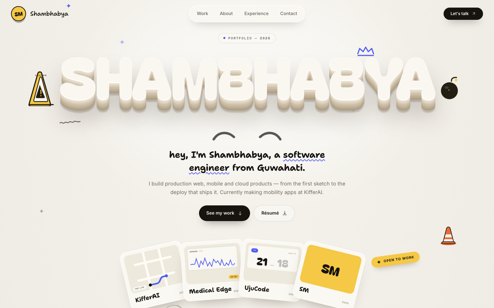
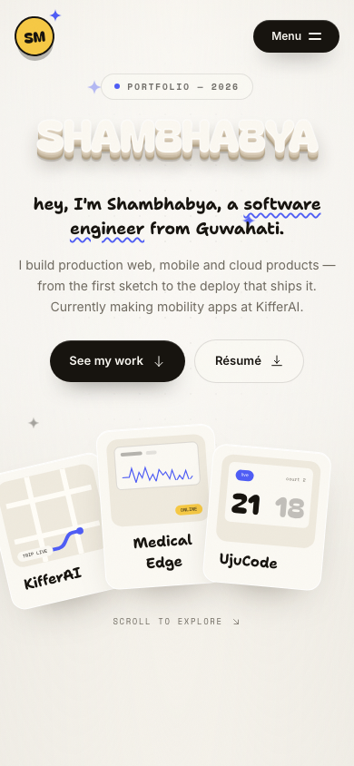
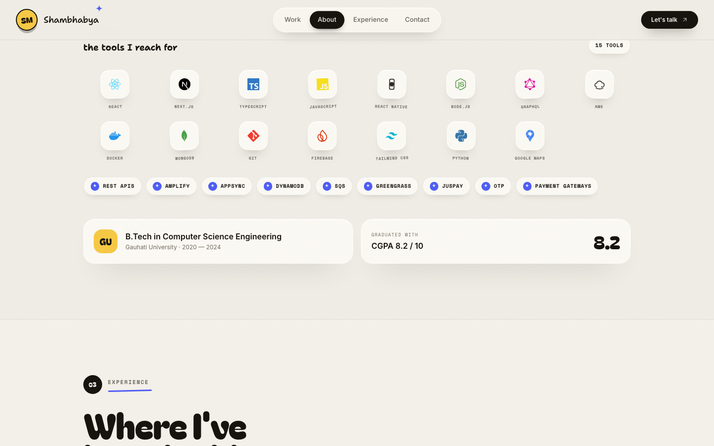

# Shambhabya Medhi — Portfolio

A playful portfolio with a tactile, toy-like feel — cream canvas, inflated 3D-style
lettering, a floating pill nav, hand-drawn doodles, fanned project cards, and a
tech-stack logo wall. Built with Next.js 16, React 19, TypeScript and Tailwind CSS 4.



<p>
  
  
</p>

## Highlights

- Inflated hero type with layered depth, floating doodles and hand-written intro
- Floating pill navigation with scroll spy and a full-screen mobile menu
- Alternating project rows with custom phone, dashboard and scoreboard mockups
- Fanned project cards, sticker labels and a soft cream card system
- Real tech logos (Simple Icons) plus custom marks for AWS services
- Fast custom star cursor, scroll reveals and reduced-motion support
- Résumé download, structured data and social metadata

## Run locally

```bash
npm install
npm run dev
```

Open [http://localhost:3000](http://localhost:3000).

To check the production build:

```bash
npm run build
npm run start
```

## Structure

```
app/
  layout.tsx        Root layout, fonts, metadata
  page.tsx          Single-page composition
  globals.css       Design tokens, motion system, custom cursor
components/
  Hero              Inflated hero, doodles and fanned cards
  Work / About / Experience / Contact
  SiteNav           Floating nav, scroll spy and mobile menu
  MotionRoot        Reveal observer, scroll progress, star cursor
  ProjectArt        Phone, dashboard and scoreboard mockups
  Doodles           Hand-drawn SVG illustrations
  TechIcon          Simple Icons logos + custom AWS marks
lib/
  site-data.ts      Résumé content and links
public/
  resume.pdf        Downloadable résumé
```

Content is sourced from `ShambhabyaMedhiResume.pdf` (kept in `public/resume.pdf`).
